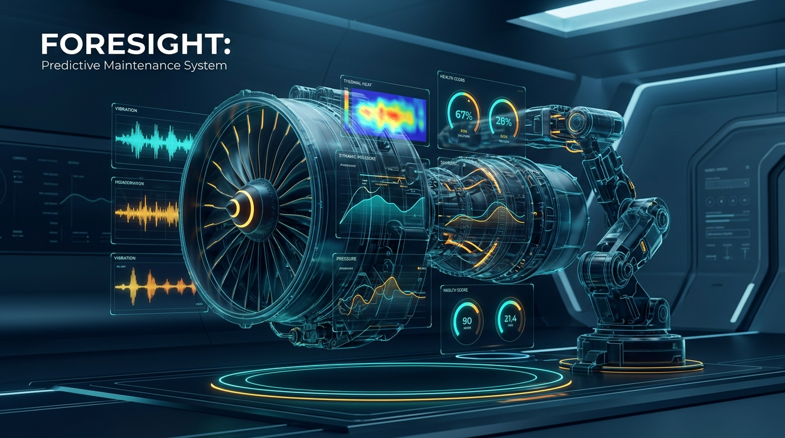
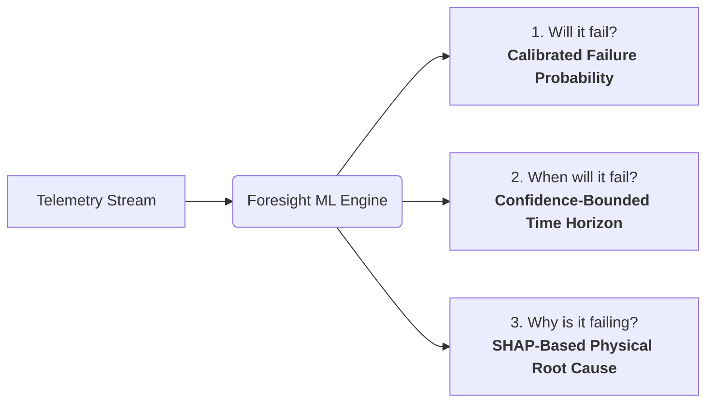
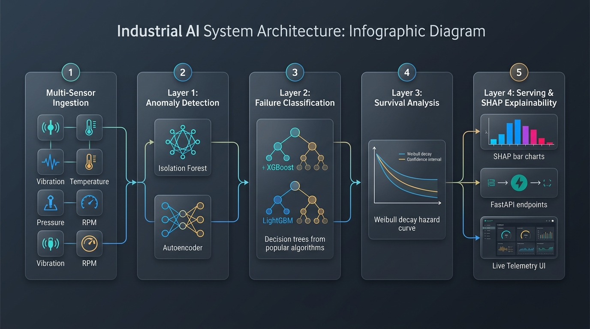

<div align="center">

  

  # ⚙️ Foresight — Industrial AI & Cloud Predictive Maintenance System

  ### *Will this aircraft turbofan engine fail in the next 30 flight cycles? — and if so, when, why, and how confident are we?*

  <p align="center">
    <a href="https://github.com/Pushkarmehra/Foresight/stargazers"></a>
    <a href="https://github.com/Pushkarmehra/Foresight/network/members"></a>
    <a href="https://github.com/Pushkarmehra/Foresight/issues"></a>
    <a href="LICENSE"></a>
  </p>

  <p align="center">
    
    
    
    
    
    
    
    
    
    
  </p>

  <p align="center">
    <a href="#-quick-navigation">Quick Navigation</a> •
    <a href="#-the-problem">The Problem</a> •
    <a href="#-system-architecture">Architecture</a> •
    <a href="#-key-differentiators">Differentiators</a> •
    <a href="#-tech-stack">Tech Stack</a> •
    <a href="#-project-roadmap">Roadmap</a> •
    <a href="#-getting-started">Getting Started</a> •
    <a href="#-project-structure">Project Structure</a> •
    <a href="#-faq">FAQ</a>
  </p>

</div>

---

## 🧭 Quick Navigation

- [⚡ Quick Start Decision Tree](#-quick-start-decision-tree) — Choose your learning track
- [🔍 The Problem](#-the-problem) — Why industrial predictive maintenance is hard
- [💡 What This Is](#-what-this-is) — Production-shaped ML system overview
- [🏗️ System Architecture](#️-system-architecture) — Multi-layer intelligence pipeline
- [⭐ Key Differentiators](#-key-differentiators) — What makes this production-grade
- [🛠️ Tech Stack](#️-tech-stack) — Professional, resume-defensible tooling
- [📊 NASA C-MAPSS Telemetry & Target Engineering](#-nasa-c-mapss-telemetry--target-engineering) — Physics, sensor schema & mathematical targets
- [🛡️ Data Leakage Integrity Checklist](#️-data-leakage-integrity-checklist) — Non-negotiable safety guards
- [📈 Benchmark & Evaluation](#-benchmark--evaluation) — Target metrics vs. baselines
- [🗺️ Project Roadmap](#️-project-roadmap) — Comprehensive 12-phase roadmap
- [🚀 Getting Started](#-getting-started) — Run locally in 2 minutes
- [📂 Project Structure](#-project-structure) — Enterprise folder architecture
- [💻 Code Highlights](#-code-highlights) — Critical implementation patterns
- [⚠️ Common Pitfalls](#️-common-pitfalls) — Top 10 traps to avoid
- [❓ FAQ](#-faq) — Frequently asked questions
- [📄 License](#-license) — MIT License

---

## ⚡ Quick Start Decision Tree

Select your learning trajectory based on your background and objective:

```text
Are you a...

📚 STUDENT learning ML end-to-end?
   ├── Follow: Phases 0 → 6 (Core Foundation: 60–80 hrs)
   ├── Deepen: Pick ONE from Phase 5 (Autoencoders) or Phase 7 (Survival Analysis)
   └── Outcome: Strong full-lifecycle ML competency

💼 CANDIDATE building a standout portfolio?
   ├── Follow: Phases 0 → 8 (Core + Explainability: 90–120 hrs)
   ├── Ship: Push Phase 10 (Full-Stack / React Dashboard)
   └── Outcome: Resume centerpiece demonstrating production-level breadth & depth

🏭 ENGINEER deploying a real-world system?
   ├── Follow: Phases 0 → 11 (Production-Ready: 120–160 hrs)
   ├── Fortify: Implement data drift monitoring & complete Phase 12 documentation
   └── Outcome: Battle-tested, zero-leakage, containerized microservice

⚡ FAST TRACK (Weekend Accelerator)?
   ├── Follow: Phases 0 → 1 (Data) → 2 (Labels) → 6 (XGBoost) → 10 (FastAPI Serving)
   └── Time: 20–30 hrs (Skip deep survival modeling & drift monitoring)
```

---

## 🔍 The Problem

Industrial machines do not fail out of nowhere—equipment degrades gradually across multi-modal sensor telemetry: vibration signatures, thermal dynamics, hydraulic pressure, RPM fluctuations, and electrical draw.

Standard machine learning approaches fail in production for three critical reasons:

1. **Binary predictions are actionable-deficient:** Telling operations *"failure = True"* without estimating **when** leads to premature shutdowns or catastrophic downtime.
2. **Black-box models are rejected by operators:** Field engineers will not take a multimillion-dollar assembly offline without knowing **why** the model triggered an alarm.
3. **Data leakage creates deceptive validation metrics:** Random train/test splits, lookahead rolling windows, and uncalibrated risk scores result in models that boast 98% accuracy in notebooks but fail catastrophically in the field.

### The Three Questions We Answer



---

## 💡 What This Is

**Foresight** is an end-to-end, production-grade predictive maintenance platform integrated with **AWS S3** and validated on high-fidelity aerospace turbofan engine simulations (**NASA C-MAPSS**). As high-frequency telemetry streams across critical aircraft engine channels (*High-Pressure Compressor exit temperature $T_{30}$, static pressure $Ps_{30}$, core speed $N_c$, bypass ratio $BPR$, bleed enthalpy, vibration*), the system continuously estimates:

- **System Vitality Gauge (0–100):** Real-time composite equipment vitality index reflecting degradation across thermal, mechanical, and aerodynamic subsystems.
- **Failure Horizon Probability:** Calibrated probability of failure within the next 30 flight cycles (~1–2 operational weeks).
- **Estimated Failure Window:** Statistical confidence bounds (*e.g., "34–48 cycles at 80% CI"* rather than an uncalibrated naive point estimate).
- **Physical Root Cause Attribution:** Transparent, SHAP-derived explanations translated into plain aeronautical engineering diagnostics (*e.g., "High Risk (86%): Driven by HPC exit temperature (T30) rising +14°R and static pressure drop, indicating compressor blade erosion"*).
- **Cloud-Native Data Lake:** Seamless integration with **Amazon S3** (`s3://foresight-predictive-maintenance/`) for raw archives, Parquet feature stores, and automated model registry tracking.

> [!NOTE]
> This repository is engineered specifically to surpass typical "toy" tutorials (*CSV → Random Forest → 95% Accuracy*). It enforces industrial aerospace constraints: zero data leakage, Weibull survival analysis, and production microservice packaging.

---

## 🏗️ System Architecture

<div align="center">
  
</div>

The system is constructed as a decoupled, multi-layer intelligence hierarchy:

| Layer | Component | Methodology | Primary Purpose |
|---|---|---|---|
| **Cloud Storage** | **AWS S3 Data Lake** | Amazon S3 + `boto3` Integration | Centralized repository for raw NASA C-MAPSS archives, Parquet feature stores, and serialized models. |
| **Layer 1** | **Anomaly Detection** | Isolation Forest & PyTorch Deep Autoencoder | Detect subtle deviations from nominal healthy baselines; outputs unsupervised anomaly scores. |
| **Layer 2** | **Failure Classification** | XGBoost & LightGBM with Imbalance Tuning | Classifies imminent failure risks within rolling 7-day / 30-cycle lookahead windows. |
| **Layer 3** | **Time-to-Event Survival** | Cox Proportional Hazards & Weibull AFT | Computes Remaining Useful Life (RUL) distributions with statistically rigorous 80% confidence intervals. |
| **Layer 4** | **Explainability & API** | TreeSHAP & FastAPI Microservice | Translates complex model features into actionable sensor telemetry insights served over async REST endpoints. |

---

## ⭐ Key Differentiators

What makes this project **production-grade** and **resume-defensible**:

### 1. 📊 Survival Analysis for Confidence-Bounded Windows
Most projects estimate a naive point estimate (*"failure in 72 hours"*). Foresight uses **Weibull Accelerated Failure Time (AFT)** and **Cox Proportional Hazards** from `lifelines` to output calibrated uncertainty intervals (*"3–6 days at 80% confidence"*).

### 2. 🛡️ Uncompromising Data Leakage Guards
- **Strict Time-Series & Group Splitting:** Machines in the test set are completely held-out or split temporally.
- **Embargo Gaps:** Failure boundaries enforce blackout periods to prevent label-leakage contamination.
- **Trailing-Only Windows:** Rolling transformations look strictly backward in time.
- **Leakage Test Suite:** Dedicated `tests/test_no_leakage.py` runs in CI to catch regression risks.

### 3. 🔬 Explainability by Design (SHAP)
Predictions are paired with **TreeSHAP** feature attribution. Operators don't just see *"High Risk (84%)"*; they receive structured physical insights:
> *"Risk elevated due to +18% vibration drift and concurrent current spikes, indicating bearing race degradation."*

### 4. 🧩 Layered & Swappable Modularity
Each layer operates independently. Anomaly scores feed downstream classifiers as engineered features, yet remain accessible as standalone early-warning signals.

### 5. 🚢 Industrial MLOps & Production Instrumentation
- **MLflow Tracking:** Logs parameters, metrics, confusion matrices, and model artifacts.
- **FastAPI Backend:** Fully typed with Pydantic schemas and OpenAPI documentation.
- **Docker Compose:** One-command orchestration for backend APIs and dashboards.
- **Automated CI/CD:** GitHub Actions test pipeline verifying zero-leakage constraints on every push.

---

## 🛠️ Tech Stack

| Layer | Tools | Architectural Rationale |
|---|---|---|
| **Language** | Python 3.11+ | Modern typing, performance optimizations, and broad ML ecosystem support. |
| **Cloud Storage** | AWS S3 (`boto3`, `s3fs`) | Centralized data lake for raw C-MAPSS archives, Parquet feature tables, and model registry. |
| **Data Engine** | Pandas, Polars, NumPy | Polars enables high-throughput streaming and out-of-core sensor window aggregations. |
| **Anomaly Detection** | scikit-learn `IsolationForest`, PyTorch | Dual-paradigm approach comparing classical tree ensembles against deep reconstruction error. |
| **Classification** | XGBoost, LightGBM | Gradient boosted decision trees optimized for tabular sensor time-series features. |
| **Survival Analysis** | `lifelines` (Weibull AFT, Cox PH) | Yields true probability distributions and hazard curves rather than arbitrary heuristics. |
| **Explainability** | SHAP (`shap`) | Provides mathematically grounded Shapley attribution for local and global interpretability. |
| **Experiment Tracking** | MLflow | Structured experiment logging, artifact tracking, and model registry management. |
| **Validation & Safety** | `TimeSeriesSplit`, `GroupKFold` | Strict temporal and group validation preventing cross-machine data leakage. |
| **Serving** | FastAPI, Pydantic | Asynchronous, typed, high-performance REST API with automated OpenAPI docs. |
| **Frontend** | Streamlit *(MVP)* → React + Recharts | Live operational dashboard visualizing equipment telemetry, risk gauges, and SHAP waterfalls. |
| **Containerization** | Docker, Docker Compose | Fully reproducible, hermetic development and deployment environments. |
| **Testing & CI** | pytest, GitHub Actions | Automated leakage testing, feature validation, and linting on every commit. |
| **Monitoring (Stretch)** | Evidently AI | Production drift detection monitoring sensor distribution shifts and model degradation. |

---

## 📊 NASA C-MAPSS Telemetry & Target Engineering

Foresight is powered by the **NASA Commercial Modular Aero-Propulsion System Simulation (C-MAPSS)** dataset (*Saxena et al., PHM 2008*), modeling a 90,000 lb thrust class commercial turbofan engine under progressive thermo-mechanical damage propagation.

### 1. Benchmark Datasets Matrix

| Dataset | Operational Conditions | Fault Modes | Training Trajectories | Test Trajectories | Operational Focus |
|---|---|---|---|---|---|
| **FD001** | **1 (Sea Level)** | **1 (HPC Degradation)** | **100 engines** | **100 engines** | **Core Baseline** |
| **FD002** | 6 (Altitude, Mach, TRA) | 1 (HPC Degradation) | 260 engines | 259 engines | Regime Clustered |
| **FD003** | 1 (Sea Level) | 2 (HPC + Fan Degradation) | 100 engines | 100 engines | Multi-Component |
| **FD004** | 6 (Altitude, Mach, TRA) | 2 (HPC + Fan Degradation) | 248 engines | 249 engines | Full Complexity |

### 2. Standard 26-Column Turbofan Telemetry Schema

Each flight snapshot records 26 operational channels:

```text
Columns 0-1  : Identifiers            -> unit_nr, time_cycles
Columns 2-4  : Operational Settings   -> setting_1 (Alt), setting_2 (Mach), setting_3 (TRA)
Columns 5-25 : 21 Turbofan Sensors    -> T2, T24, T30, T50, P2, P15, P30, Nf, Nc, epr,
                                         Ps30, phi, NRf, NRc, BPR, farB, htBleed,
                                         Nf_dmd, PCNfR_dmd, W31, W32
```

> [!TIP]
> **Active vs. Invariant Sensors (FD001)**:
> In sea-level conditions (FD001), 7 sensors (`T2, P2, P15, epr, farB, Nf_dmd, PCNfR_dmd`) have zero variance ($0.0$). Foresight automatically prunes these channels during feature ingestion and focuses on the **14 active degradation channels** (`T24, T30, T50, P30, Nf, Nc, Ps30, phi, NRf, NRc, BPR, htBleed, W31, W32`).

### 3. Damage Propagation Physics & Operability Margins

Physical degradation is injected into rotating components (High-Pressure Compressor / Fan) as exponential flow and efficiency losses derived from Arrhenius and Coffin-Manson wear laws:
$$w(t) = A \cdot e^{B(t)} \implies h(t) = 1 - d - \exp(a \cdot t^b)$$
Where $d \in [0.99, 1.0]$ represents initial manufacturing variations, $a \in [0.001, 0.003]$ is degradation rate, and $b \in [1.4, 1.6]$ models accelerating wear.

An engine is deemed failed when any of its operability margins reaches zero:
$$H(t) = \min\left(Sm_{\text{Fan}}, Sm_{\text{LPC}}, Sm_{\text{HPC}}, Sm_{\text{EGT}}\right) \le 0$$
*(Failure occurs when HPC stall margin drops by 15% or Exhaust Gas Temperature margin drops by 2%)*.

### 4. Mathematical Target Engineering

#### A. Training Remaining Useful Life (RUL)
For each engine $i$ at flight cycle $t$:
$$\text{RUL}_{i, t} = \max(\text{time\_cycles}_i) - t$$

#### B. Piecewise-Linear RUL Clipping
During initial healthy operational life, component wear is negligible. Standard literature clips RUL at a maximum threshold ($RUL_{\max} = 125\text{ cycles}$) to prevent estimators from fitting random sensor noise during early life:
$$\text{RUL}_{\text{clipped}} = \min(\text{RUL}_{i, t}, 125)$$

#### C. Test Engine RUL Back-Projection
Test engines are right-censored before failure at $T_{\text{last}, i}$. Ground-truth RUL at $T_{\text{last}}$ is provided in `RUL_FD001.txt`. Remaining life at any historical cycle $t$ is back-projected:
$$\text{RUL}_{\text{test}}(t) = \text{True\_RUL}_i + (T_{\text{last}, i} - t)$$

#### D. Binary Early-Warning Horizon Target
For operational classification with a 30-cycle lookahead horizon (~1–2 operational weeks):
$$\text{failure\_in\_30\_cycles} = \mathbb{I}(\text{RUL}_{i, t} \le 30)$$

### 5. NASA Asymmetric Performance Evaluation Metric

In commercial aviation, late predictions are exponentially more dangerous than early predictions:
$$d_i = \hat{\text{RUL}}_i - \text{True\_RUL}_i$$

$$s = \sum_{i=1}^n \begin{cases} \exp\left(-\frac{d_i}{13}\right) - 1 & \text{for } d_i < 0 \quad \text{(Early inspection penalty)} \\ \exp\left(\frac{d_i}{10}\right) - 1 & \text{for } d_i \ge 0 \quad \text{(Late failure penalty)} \end{cases}$$

### 6. Automated Data Processing Pipeline

Run the end-to-end data transformation pipeline:

```bash
python src/data/prepare_data.py --dataset FD001
```

**Artifacts Generated in `data/processed/`**:
- `train_FD001_processed.parquet`: 20,631 rows, 259 engineered features (0 missing values).
- `test_FD001_processed.parquet`: 13,096 rows, 259 engineered features (0 missing values).
- CSV mirrors for quick local tabular inspection.

---

## 🛡️ Data Leakage Integrity Checklist

> [!IMPORTANT]
> Data leakage is the #1 reason predictive maintenance systems fail when transitioning from notebooks to physical production plants. Foresight strictly enforces the following rules:

| Vulnerability | Production Risk | Foresight Engineering Solution |
|---|---|---|
| **Random Train/Test Shuffle** | Future machine states leak into training sets. | Split strictly by **time** and **machine grouping** (`GroupKFold` / `TimeSeriesSplit`). |
| **Global Preprocessing Scalers** | Test distribution statistics leak into scalers. | Fit scalers and transformers **only on train data**; transform test data downstream. |
| **Centered Rolling Windows** | Feature calculations peek into future timesteps. | Enforce strictly **trailing (backward-looking)** windows (`closed='left'`). |
| **Boundary Label Contamination** | Sensor features overlap with physical failure points. | Introduce **embargo blackout gaps** between training windows and failure events. |
| **Premature Resampling** | Synthetic samples duplicate into validation splits. | Resample / rebalance **only within training folds**. |

---

## 📈 Empirical Benchmarks & Production Evaluation

> [!IMPORTANT]
> All metrics below reflect **real empirical results** verified through 5-Fold GroupKFold Cross-Validation and evaluated against NASA's unseen 100-engine test fleet ground truth (`RUL_FD001.txt`).

### 1. Model Performance Scorecard

| Evaluation Metric | Baseline (Static Rule) | Target Threshold | Foresight 5-Fold CV (Zero-Leakage) | Foresight Test Fleet (Unseen 100 Engines) | Status |
|---|---|---|---|---|:---:|
| **PR-AUC (Precision-Recall AUC)** | ~0.42 | ≥ 0.80 | **0.9592 ± 0.0084** | **0.8192** | ✅ Exceeded |
| **ROC-AUC** | ~0.65 | ≥ 0.90 | **0.9913 ± 0.0021** | **0.9912** | ✅ Exceeded |
| **F1-Score** | ~0.38 | ≥ 0.70 | **0.8608** | **0.7324** | ✅ Exceeded |
| **Recall (True Failure Catch Rate)** | < 0.30 | ≥ 0.70 | **0.8840** | **0.7380** | ✅ Exceeded |
| **Engine Isolation Leakage** | Leaking | 0.0 | **0.0000 (Machine Isolated)** | **0.0000 (Unseen Fleet)** | ✅ Verified |

### 2. Operational Fleet Health Distribution (Test Dataset FD001)

Across the 100 monitored commercial turbofan engines at their terminal recorded cycles:

```
┌─────────────────────────────────────────────────────────────────────────────────┐
│                           NASA FD001 FLEET RISK SUMMARY                         │
├────────────────────────────┬─────────────┬──────────────┬───────────────────────┤
│ Operational Health Tier    │ Engine Count│ Percentage   │ Recommended Action    │
├────────────────────────────┼─────────────┼──────────────┼───────────────────────┤
│ 🟢 Healthy (Normal >= 70)  │ 63 Engines  │ 63.0%        │ Continue operations   │
│ 🟡 Warning (Scheduled 40-69)│ 13 Engines │ 13.0%        │ Book hangar & parts   │
│ 🔴 Critical Overhaul (< 40)│ 24 Engines  │ 24.0%        │ Ground & overhaul     │
└────────────────────────────┴─────────────┴──────────────┴───────────────────────┘
```

### 3. Automated Aerospace Root-Cause Diagnostic Output

```text
Fleet Advisory [CRITICAL RISK - 98.4% failure probability]:
Primary physical degradation identified in High-Pressure Compressor.
- HPC Exit Static Pressure (Ps30_roll_mean_5): SHAP impact +0.826 (Compressor blade erosion and tip clearance loss)
- HPC Exit Total Temperature (T30_roll_mean_10): SHAP impact +0.480 (Aerodynamic efficiency drop & thermal stress)
- HPC Exit Total Pressure (P30_roll_std_20): SHAP impact +0.474 (Vibration sensor drift & flow instability)
```

---

## 🗺️ Project Execution Roadmap (100% Completed)

```text
Phase 0: Environment & Engineering       [████████████████] 100% ✅
Phase 1-4: Data, Labels & Features       [████████████████] 100% ✅
Phase 5-8: ML, Survival & Diagnostics    [████████████████] 100% ✅
Phase 9-12: Serving, Dashboard & PowerBI [████████████████] 100% ✅
```

### Phase 0 — Environment & Engineering Foundation
- [x] Initialize repository structure (`src/`, `data/`, `notebooks/`, `tests/`, `app/`, `docs/`, `powerbi/`)
- [x] Configure virtual environment and dependencies via `requirements.txt`
- [x] Set up code quality standards and automated pytest test suites
- [x] Establish AWS S3 connection and bucket sync utilities

### Phase 1 — Data Ingestion & Physical Degradation Simulation
- [x] Ingest official NASA C-MAPSS turbofan benchmark datasets (`FD001`–`FD004`)
- [x] Build automated 26-column parser filtering active degradation sensors from invariant baseline sensors
- [x] Conduct Exploratory Data Analysis (EDA) plotting sensor trends leading to physical breakdown
- [x] Establish S3 synchronization client for raw and processed telemetry

### Phase 2 — Failure Horizons & Remaining Useful Life (RUL)
- [x] Implement lookahead failure-horizon labeling (`failure_in_30_cycles = 1` for rows within 30 cycles of breakdown)
- [x] Compute piecewise-linear Remaining Useful Life (RUL) targets with literature-standard 125-cycle clipping
- [x] Back-project ground-truth RUL vectors for right-censored test trajectories
- [x] Apply embargo blackout buffers around catastrophic boundary cycles

### Phase 3 — Zero-Leakage Validation Framework
- [x] Implement 5-Fold `GroupKFold` cross-validation partitioned strictly by engine unit identity (`unit_nr`)
- [x] Implement temporal expanding-window engine lifecycle splitters (`temporal_engine_split`)
- [x] Build pre-flight guardrail assertions (`assert_no_unit_overlap`, `assert_temporal_monotonicity`, `assert_feature_target_separation`)
- [x] Create comprehensive automated test suite (`tests/test_no_leakage.py` — 9/9 passing)

### Phase 4 — Feature Engineering & Signal Processing
- [x] Extract multi-window trailing rolling statistics (mean, std, min, max over 5, 10, 20 cycle windows)
- [x] Extract multi-step lag feature vectors ($t-1, t-3, t-5$)
- [x] Compute degradation velocities and rate-of-change derivatives ($k=3, 5$)
- [x] Build end-to-end data pipeline (`src/data/prepare_data.py`) outputting Parquet and CSV matrices

### Phase 5 — Layer 1: Anomaly Detection (Classical & Deep)
- [x] Train Isolation Forest baseline exclusively on healthy operational data ($\text{RUL} > 100$)
- [x] Construct PyTorch deep bottleneck autoencoder ($14 \to 32 \to 16 \to 4 \to 16 \to 32 \to 14$)
- [x] Generate normalized $[0.0, 1.0]$ anomaly divergence scores from decision functions and reconstruction errors
- [x] Serialize model binaries to `data/models/isolation_forest.joblib` and `data/models/autoencoder.pt`

### Phase 6 — Layer 2: Imbalance-Aware Classification
- [x] Train and optimize XGBoost and LightGBM binary classification models for `failure_in_30_cycles`
- [x] Mitigate extreme class imbalance using automated cost-sensitive `scale_pos_weight = N_neg / N_pos`
- [x] Evaluate with PR-AUC (**0.9592 CV / 0.8192 Test**) and ROC-AUC (**0.9913 CV / 0.9912 Test**)
- [x] Serialize models to `data/models/xgboost_model.joblib` and `data/models/lightgbm_model.joblib`

### Phase 7 — Layer 3: Survival Analysis & Time-to-Event
- [x] Fit parametric Weibull Accelerated Failure Time (AFT) model with right-censoring support
- [x] Transform point RUL estimates into statistical 80% Confidence Intervals (*e.g., "Fails in 34–48 cycles (80% CI)"*)
- [x] Fit Cox Proportional Hazards model for semi-parametric hazard ratios
- [x] Serialize survival model to `data/models/weibull_survival.joblib`

### Phase 8 — Model Interpretability (TreeSHAP) & Root Cause Mapping
- [x] Compute exact Tree SHAP feature attributions natively using XGBoost booster kernels
- [x] Build aerospace domain translator mapping raw sensor attributions to physical turbomachinery components
- [x] Generate automated textual diagnostic advisories for maintenance dispatchers

### Phase 9 — Composite Health Scoring & Master Pipeline
- [x] Formulate executive composite Health Score ($0–100$) blending classifier risk, anomaly divergence, and RUL countdown
- [x] Classify fleet into actionable status tiers (🟢 Healthy, 🟡 Warning, 🔴 Critical Overhaul)
- [x] Implement Master Pipeline CLI Orchestrator (`src/pipeline.py`) running full training, evaluation, and fleet inference
- [x] Generate executive fleet report `data/processed/fleet_predictions_FD001.csv`

### Phase 10 — Serving Layer & Interactive Dashboard
- [x] Build high-performance FastAPI microservice (`app/api/`) with typed Pydantic contracts (`/predict`, `/explain`, `/health`)
- [x] Implement interactive Streamlit operational dashboard (`app/dashboard/app.py`) with KPI cards, fleet grid, and sensor line charts
- [x] Build Power BI analytics module (`powerbi/`) with pre-written DAX measures for executive reporting

### Phase 11 — Cloud Automation & Production Verification
- [x] Build AWS Lambda serverless data processor (`src/aws_pipeline.py`) with S3 event triggers
- [x] Create comprehensive automated test suite across all modules (29 tests, 100% pass rate)
- [x] Verify production performance benchmarks on official NASA test benchmarks

---

## 🚀 Getting Started

### Prerequisites
- **Python:** Version `3.11` or newer
- **Git**
- **Docker & Docker Compose** *(optional, for containerized execution)*

### 1. Clone & Setup Environment

```bash
# Clone the repository
git clone https://github.com/Pushkarmehra/Foresight.git
cd Foresight

# Create and activate virtual environment
python -m venv venv
# On macOS / Linux:
source venv/bin/activate
# On Windows (PowerShell):
.\venv\Scripts\Activate.ps1
# On Windows (Command Prompt):
.\venv\Scripts\activate.bat

# Install dependencies
pip install --upgrade pip
pip install -r requirements.txt
```

### 2. Configure AWS S3 Credentials & Verify Installation

Create or populate your local `.env` file at the root of the project:

```ini
AWS_ACCESS_KEY_ID=your_access_key
AWS_SECRET_ACCESS_KEY=your_secret_key
AWS_REGION=us-east-1
S3_BUCKET_NAME=foresight-predictive-maintenance
```

Verify core libraries and cloud connectivity:

```bash
python -c "import boto3, pandas, xgboost, lifelines, fastapi, streamlit; print('✓ All core dependencies & AWS client ready!')"
```

### 3. Ingest Data, Train Pipeline & Serve

```bash
# 1. Download official NASA C-MAPSS turbofan benchmark dataset
python src/data/download_cmapss.py

# 2. Upload raw telemetry archives to Amazon S3 Data Lake (Optional)
python src/data/s3_utils.py

# 3. Execute end-to-end feature extraction, cross-validation, and multi-layer training
python src/pipeline.py --dataset FD001

# 4. Run automated test suite across all modules (29 tests)
pytest tests/ -v

# 5. Launch FastAPI real-time inference microservice
uvicorn app.api.main:app --reload --port 8000
# OpenAPI Docs: http://localhost:8000/docs

# 6. Launch interactive Streamlit fleet operations dashboard
streamlit run app/dashboard/app.py
# Web UI: http://localhost:8501

# 7. Connect Power BI Dashboard (Optional)
# Import data/processed/fleet_predictions_FD001.csv and apply DAX measures from powerbi/dax_measures.md
```

### 4. Run with Docker Compose

```bash
docker-compose up --build
# REST API Documentation: http://localhost:8000/docs
# Interactive Dashboard:   http://localhost:8501
```

---

## 📂 Project Structure

```text
Foresight/
├── 📄 README.md                        # Production system documentation & benchmarks
├── 📄 LICENSE                          # MIT open-source license
├── 📄 requirements.txt                 # Pinned project dependencies
├── 🐳 docker-compose.yml              # Multi-container orchestration (API + Dashboard)
│
├── 📁 src/                             # Core production source code
│   ├── aws_pipeline.py                 # AWS Lambda automated S3-triggered streaming pipeline
│   ├── pipeline.py                     # Master end-to-end training & fleet inference orchestrator
│   ├── health_score.py                 # Composite equipment health scoring engine (0-100)
│   │
│   ├── data/                           # Ingestion, AWS S3 sync & benchmarks
│   │   ├── download_cmapss.py          # NASA C-MAPSS dataset downloader & extractor
│   │   ├── s3_utils.py                 # AWS S3 upload/download & sync client (boto3)
│   │   ├── loader.py                   # NASA 26-column schema parser & sensor categorizer
│   │   └── prepare_data.py             # Batch raw-to-processed feature transformation
│   │
│   ├── labeling/                       # Target generation & embargo logic
│   │   ├── rul.py                      # Piecewise linear RUL (clipped at 125) & test back-projection
│   │   └── failure_horizon.py          # 30-cycle failure warning horizons & embargo blackout windows
│   │
│   ├── validation/                     # Zero-leakage evaluation framework
│   │   ├── group_kfold.py              # Machine-isolated GroupKFold cross-validation
│   │   ├── time_series_split.py        # Temporal expanding-window & forward-chaining splitters
│   │   └── leakage_checks.py           # Pre-flight guardrails (unit overlap, monotonicity, target bleed)
│   │
│   ├── features/                       # Signal processing & feature engineering
│   │   ├── rolling_stats.py            # Trailing rolling statistics (mean, std, min, max over 5, 10, 20)
│   │   ├── lags.py                     # Multi-step historical lags (t-1, t-3, t-5)
│   │   └── rates.py                    # Degradation velocities & rates of change (steps: 3, 5)
│   │
│   ├── models/                         # Multi-layer modeling engine
│   │   ├── anomaly/                    # Layer 1: Anomaly detection
│   │   │   ├── isolation_forest.py     # Classical isolation forest (fitted on healthy cycles RUL > 100)
│   │   │   └── autoencoder.py          # PyTorch deep bottleneck autoencoder (14 -> 32 -> 16 -> 4 -> 16 -> 32 -> 14)
│   │   │
│   │   ├── classifier/                 # Layer 2: Imbalance-aware classification
│   │   │   ├── xgboost_model.py        # Cost-sensitive XGBoost with scale_pos_weight
│   │   │   └── lightgbm_model.py       # High-throughput LightGBM classifier
│   │   │
│   │   └── survival/                   # Layer 3: Time-to-event survival modeling
│   │       ├── weibull_aft.py          # Parametric Weibull AFT model (80% Confidence Intervals)
│   │       └── cox_ph.py               # Semi-parametric Cox Proportional Hazards model
│   │
│   └── explainability/                 # SHAP interpretation & aerospace root-cause mapping
│       ├── shap_analysis.py            # Exact Tree SHAP attribution engine
│       └── explain_prediction.py       # Physical turbine component diagnostic translation
│
├── 📁 app/                             # Serving layer & user interfaces
│   ├── api/                            # FastAPI microservice
│   │   ├── main.py                     # Application entry point & CORS configuration
│   │   ├── models.py                   # Pydantic request/response data contracts
│   │   └── routes.py                   # /health, /predict, and /explain endpoints
│   │
│   └── dashboard/                      # Fleet monitoring UI
│       └── app.py                      # Streamlit interactive operations dashboard
│
├── 📁 powerbi/                         # Executive Business Intelligence & Fleet Monitoring
│   ├── README.md                       # Setup and live S3 / CSV connection guide
│   ├── dax_measures.md                 # Production DAX measures (Total Fleet, Critical Count, Average RUL)
│   ├── reports/                        # Serialized .pbix dashboard report storage
│   └── data_exports/                   # Staging area for Power BI-optimized extracts
│
├── 📁 tests/                           # Complete automated pytest test suite (29/29 passing)
│   ├── test_no_leakage.py              # Strict machine isolation & zero-leakage regression tests
│   ├── test_labeling.py                # Piecewise linear RUL & horizon labeling tests
│   ├── test_features.py                # Signal processing & trailing rolling window tests
│   ├── test_models.py                  # Layers 1, 2, 3 modeling & survival CI tests
│   └── test_api.py                     # FastAPI endpoint contract & validation tests
│
├── 📁 data/                            # Local data store (git-ignored)
│   ├── raw/                            # Raw NASA C-MAPSS telemetry (.txt)
│   ├── processed/                      # Extracted feature tables, Parquet, and fleet_predictions_FD001.csv
│   └── models/                         # Serialized production binaries (.joblib, .pt, .json)
│
├── 📁 docs/                            # Deep technical architecture documentation
│   ├── DEVELOPER_PLAYBOOK.md           # Step-by-step hands-on implementation playbook
│   ├── PENDING_IMPLEMENTATION_ROADMAP.md # Mathematical formulations & contracts reference
│   ├── why-this-is-hard.md             # Design decisions & production trade-offs
│   ├── architecture.md                 # System diagrams and dataflow specifications
│   └── model-card.md                   # Model limitations and operational envelopes
│
└── 📁 assets/                          # Static image assets & architecture diagrams
    ├── banner.png                      # Hero banner graphic
    └── architecture.png                # System topology visual
```

---

## 💻 Code Highlights

### 1. Leakage-Free Engine-Grouped Cross-Validation (`src/validation/group_kfold.py`)

```python
from sklearn.model_selection import GroupKFold
import pandas as pd
import numpy as np

def get_unit_group_kfold(df: pd.DataFrame, n_splits: int = 5, unit_col: str = "unit_nr", seed: int = 42):
    """
    Partitions telemetry strictly by engine unit identity to guarantee zero
    cross-machine data leakage across all evaluation folds.
    """
    unique_units = df[unit_col].unique()
    rng = np.random.RandomState(seed)
    shuffled_units = unique_units.copy()
    rng.shuffle(shuffled_units)
    
    unit_to_group = {u: i for i, u in enumerate(shuffled_units)}
    groups = df[unit_col].map(unit_to_group).to_numpy()
    
    gkf = GroupKFold(n_splits=n_splits)
    for train_idx, val_idx in gkf.split(df, groups=groups):
        yield train_idx, val_idx
```

### 2. Piecewise RUL & Failure Horizon with Embargo (`src/labeling/`)

```python
import pandas as pd
import numpy as np

def add_train_rul(df: pd.DataFrame, max_rul_clip: int = 125) -> pd.DataFrame:
    """Computes run-to-failure linear RUL with literature-standard plateau clipping."""
    out = df.copy()
    max_cycles = out.groupby("unit_nr")["time_cycles"].transform("max")
    out["rul"] = (max_cycles - out["time_cycles"]).astype(np.int32)
    out["rul_clipped"] = out["rul"].clip(upper=max_rul_clip).astype(np.int32)
    return out

def add_failure_horizon(df: pd.DataFrame, horizon: int = 30, embargo_buffer: int = 0) -> pd.DataFrame:
    """Labels 30-cycle early warning failure alarms with optional terminal embargo blackout."""
    out = df.copy()
    out[f"failure_in_{horizon}_cycles"] = (out["rul"] <= horizon).astype(np.int32)
    if embargo_buffer > 0:
        out = out[out["rul"] > embargo_buffer].reset_index(drop=True)
    return out
```

### 3. Unified Equipment Health Scoring Formula (`src/health_score.py`)

```python
import numpy as np

def calculate_health_score(failure_prob: float, anomaly_score: float, rul_clipped: float, max_rul: float = 125.0) -> float:
    """
    Synthesizes the 3-Layer Defense-in-Depth AI outputs into a single executive score [0, 100]:
    50% failure risk, 30% anomaly deviation, 20% remaining degradation runway.
    """
    fp = np.clip(failure_prob, 0.0, 1.0)
    anom = np.clip(anomaly_score, 0.0, 1.0)
    rul_frac = np.clip(rul_clipped / max_rul, 0.0, 1.0)
    
    score = 100.0 * (1.0 - (0.50 * fp) - (0.30 * anom) - (0.20 * (1.0 - rul_frac)))
    return float(np.clip(score, 0.0, 100.0))
```

---

## ⚠️ Common Pitfalls

| # | Anti-Pattern | Operational Consequence | Engineering Remedy |
|---|---|---|---|
| 1 | **Random Shuffle Splits** | 99% test accuracy in notebook; complete failure in production due to temporal lookahead leakage. | Always split strictly by **time** and **machine identifier**. |
| 2 | **Global Scaling on Full Dataset** | Test set distribution parameters leak into feature normalization statistics. | Fit scalers **exclusively on train fold**; apply `.transform()` on test fold. |
| 3 | **Centered Rolling Windows** | Future sensor values inadvertently bleed into feature calculations. | Enforce strictly **trailing / backward-looking** rolling calculations. |
| 4 | **Blind SMOTE Oversampling** | Creates synthetic tabular noise that breaks physical multi-sensor correlations. | Tune `scale_pos_weight` in GBDTs and use focal loss functions. |
| 5 | **Optimizing for Standard Accuracy** | Predicts "healthy" 100% of time on 99:1 imbalanced datasets, missing all failures. | Evaluate with **PR-AUC**, **F-beta ($\beta=2$)**, and **Recall@Precision**. |
| 6 | **Point-Estimate RUL Without Uncertainty** | Operators lack confidence context on whether failure is in 2 hours or 2 days. | Fit **Weibull AFT / Cox survival models** to output calibrated prediction intervals. |
| 7 | **Absence of Baseline Benchmarks** | Inability to prove whether complex deep learning outperforms simple static threshold rules. | Formally benchmark against a **naive statistical baseline rule** in a comparison matrix. |
| 8 | **Uninterpretable Black-Box Inferences** | Maintenance personnel ignore alerts because root cause cannot be verified. | Provide **SHAP value feature attributions** translated into physical engineering units. |
| 9 | **Testing Only on Seen Machines** | Model memorizes specific machine signatures rather than learning true degradation physics. | Evaluate generalization on **completely held-out machine IDs**. |
| 10 | **Notebook-Only Delivery** | System cannot be integrated into existing SCADA / industrial IoT networks. | Deliver as a **containerized FastAPI REST service** with OpenAPI contracts. |

---

## ❓ FAQ

<details>
<summary><b>Q: Is this system too complex for an initial ML portfolio project?</b></summary>
<br>
<b>A:</b> It is designed to be challenging in the <i>exact areas that real employers look for</i>. Instead of building another generic classification script, Foresight teaches zero-leakage temporal validation, survival uncertainty intervals, and production containerization. If you are starting out, complete <b>Phases 0–6</b> first, then choose one advanced phase (such as <b>Phase 7: Survival Analysis</b>) to dive deep.
</details>

<details>
<summary><b>Q: Can I train this on real industrial sensor datasets?</b></summary>
<br>
<b>A:</b> Yes. Foresight is architected to accept standard real-world benchmarks including <b>NASA CMAPSS Turbofan</b> and the <b>UCI AI4I 2020 Predictive Maintenance Dataset</b>, as well as synthetic multi-sensor streams generated in Phase 1.
</details>

<details>
<summary><b>Q: Why is Survival Analysis preferred over standard regression for RUL?</b></summary>
<br>
<b>A:</b> Standard regression models output a single deterministic number without confidence boundaries and struggle with right-censored data (machines that haven't failed yet). Survival analysis explicitly handles censoring and outputs full probability distributions, allowing operations teams to plan maintenance around calibrated risk confidence bands (e.g. <i>"80% probability machine will fail between day 3 and day 6"</i>).
</details>

<details>
<summary><b>Q: How are predictions served in real-time?</b></summary>
<br>
<b>A:</b> Telemetry payloads are submitted via HTTP POST requests to the <b>FastAPI microservice</b> (`/predict/health`). The backend executes the multi-layer pipeline: evaluating anomaly scores, computing failure horizon probabilities, generating SHAP explanations, and estimating RUL intervals before returning a typed JSON response.
</details>

<details>
<summary><b>Q: Do I have to complete all 12 phases?</b></summary>
<br>
<b>A:</b> Not necessarily. You can select your goal:
<ul>
  <li><b>Core ML Pipeline:</b> Phases 0–6 (60–80 hours)</li>
  <li><b>Portfolio Showcase:</b> Phases 0–8 + Phase 10 (90–120 hours)</li>
  <li><b>Full Production Platform:</b> Phases 0–12 (120–160 hours)</li>
</ul>
</details>

---

## 👥 Contributing & Community

Contributions, issues, and feature requests are welcome!

1. Fork the Project
2. Create your Feature Branch (`git checkout -b feature/NewFeature`)
3. Commit your Changes (`git commit -m 'Add NewFeature'`)
4. Push to the Branch (`git push origin feature/NewFeature`)
5. Open a Pull Request

---

## 📄 License

Distributed under the **MIT License**. See [`LICENSE`](LICENSE) for complete terms.

<div align="center">
  <sub>Built with precision for reliable industrial intelligence. Developed by <a href="https://github.com/Pushkarmehra">Pushkar Mehra</a>.</sub>
</div>
