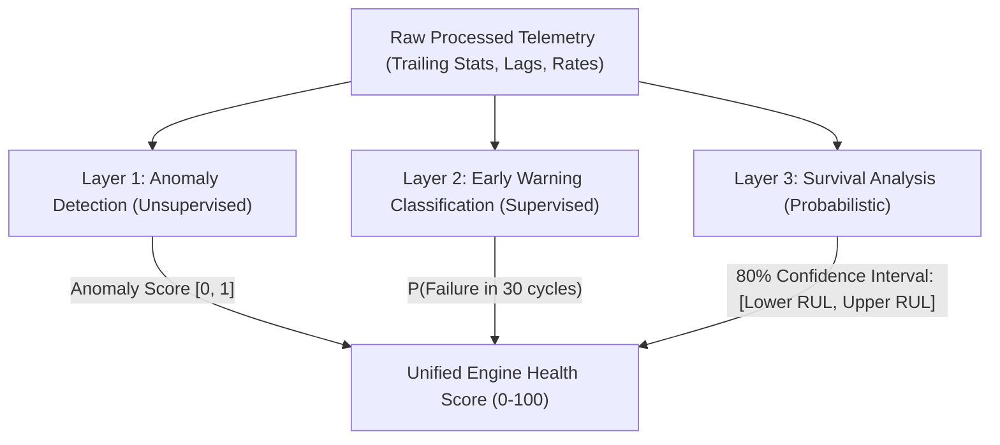

# 🧭 Foresight Architecture & Learning Roadmap

This document serves as your complete conceptual guide, mathematical blueprint, and implementation checklist for:
1. **Step 5: Target Labeling & Embargo Windows** (`rul.py`, `failure_horizon.py`)
2. **Step 6: Zero-Leakage Validation Framework** (`group_kfold.py`, `time_series_split.py`, `leakage_checks.py`, `test_no_leakage.py`)
3. **All Pending Future Phases** (Layers 1–3 Modeling, Explainability, Orchestration, and Serving)

---

## 📑 Table of Contents
- [Phase 2 (Step 5): Target Labeling & Embargo Windows](#phase-2-step-5-target-labeling--embargo-windows)
  - [1. `src/labeling/rul.py`](#1-srclabelingrulpy)
  - [2. `src/labeling/failure_horizon.py`](#2-srclabelingfailure_horizonpy)
- [Phase 3 (Step 6): Zero-Leakage Validation Framework](#phase-3-step-6-zero-leakage-validation-framework)
  - [1. `src/validation/group_kfold.py`](#1-srcvalidationgroup_kfoldpy)
  - [2. `src/validation/time_series_split.py`](#2-srcvalidationtime_series_splitpy)
  - [3. `src/validation/leakage_checks.py`](#3-srcvalidationleakage_checkspy)
  - [4. `tests/test_no_leakage.py`](#4-teststest_no_leakagepy)
- [Phase 5 (Steps 8–10): Multi-Layer Modeling Engine](#phase-5-steps-810-multi-layer-modeling-engine)
  - [Step 8: Layer 1 Anomaly Detection](#step-8-layer-1-anomaly-detection)
  - [Step 9: Layer 2 Imbalance-Aware Classification](#step-9-layer-2-imbalance-aware-classification)
  - [Step 10: Layer 3 Weibull Survival Analysis](#step-10-layer-3-weibull-survival-analysis)
- [Phase 6 (Step 11): Explainability & Health Scoring](#phase-6-step-11-explainability--health-scoring)
- [Phase 7 (Step 12): Master Pipeline Orchestrator](#phase-7-step-12-master-pipeline-orchestrator)
- [Phase 8 (Step 13): Serving Layer & Fleet Dashboard](#phase-8-step-13-serving-layer--fleet-dashboard)

---

## 🎯 Phase 2 (Step 5): Target Labeling & Embargo Windows

### 1. `src/labeling/rul.py`
**Objective**: Compute the Remaining Useful Life (RUL) for each engine trajectory.

#### 💡 The Problem & Physics
In commercial jet engines, machines operate in a healthy steady-state for hundreds of flight cycles before measurable wear initiates. If we train an ML model on pure linear degradation ($RUL = T_{\max} - t$), the model tries to distinguish cycle 250 from cycle 200 even though the sensor telemetry is identical (zero physical wear).
Therefore, standard aerospace literature (Heimes et al., Saxena et al.) applies **Piecewise Linear Clipping**:

$$\text{RUL}_{\text{clipped}} = \min(\text{RUL}, \text{max\_clip}) \quad (\text{default: } 125 \text{ cycles})$$

#### 📐 Mathematical Formulations
1. **Training Set (Run-to-Complete-Failure)**:
   For each engine unit $i$, find its final failure cycle $T_{\max, i} = \max(t)$.
   $$\text{RUL}_{i, t} = T_{\max, i} - t$$

2. **Test Set (Right-Censored Trajectories)**:
   Test trajectories terminate prematurely at cycle $T_{\text{last}, i}$ before failure occurs.
   NASA provides the ground truth remaining life at that terminal cycle in `RUL_FD00x.txt` as $\text{True\_RUL}_i$.
   We must **back-project** the true RUL to all prior test cycles $t$:
   $$\text{RUL}_{\text{test}}(i, t) = \text{True\_RUL}_i + (T_{\text{last}, i} - t)$$

#### 🛠️ Function Contracts to Implement
```python
def add_train_rul(df: pd.DataFrame, max_rul_clip: Optional[int] = 125) -> pd.DataFrame:
    """
    1. Group df by 'unit_nr' and get max('time_cycles').
    2. Compute df['rul'] = max_cycles - df['time_cycles'].
    3. If max_rul_clip > 0: df['rul_clipped'] = df['rul'].clip(upper=max_rul_clip).
    4. Return updated copy of DataFrame.
    """

def add_test_rul(test_df: pd.DataFrame, rul_df: pd.DataFrame, max_rul_clip: Optional[int] = 125) -> pd.DataFrame:
    """
    1. Group test_df by 'unit_nr' and get max('time_cycles') as T_last.
    2. Merge rul_df[['unit_nr', 'true_rul']] onto test_df.
    3. Compute test_df['rul'] = test_df['true_rul'] + (T_last - test_df['time_cycles']).
    4. Apply piecewise clipping to create 'rul_clipped'.
    5. Drop intermediate 'true_rul' column and return DataFrame.
    """
```

---

### 2. `src/labeling/failure_horizon.py`
**Objective**: Construct binary early-warning failure alarm labels for predictive maintenance dispatching.

#### 💡 The Operational Concept
Airline fleet operators do not schedule engine overhaul on the day of failure. They need an **Early Warning Horizon** (typically 30 cycles, roughly 1–2 weeks of commercial operations) to ferry replacement turbofans, schedule hangar downtime, and allocate technicians.

#### 📐 Mathematical Formulation
$$\text{failure\_in\_horizon}(t) = \begin{cases} 1 & \text{if } \text{RUL}_t \le W \\ 0 & \text{if } \text{RUL}_t > W \end{cases} \quad (W = 30 \text{ cycles})$$

#### 🛡️ Embargo Window (Blackout Buffer)
In physical machinery, the last 2–5 cycles immediately before total failure exhibit catastrophic non-linear boundary shocks (rapid thermal runaway, sensor saturation, severe vibration).
- An **embargo buffer** (e.g., `embargo_buffer=3`) filters out rows where $\text{RUL} \le \text{embargo\_buffer}$ to prevent extreme outliers from corrupting gradient calculations.

#### 🛠️ Function Contracts to Implement
```python
def add_failure_horizon(
    df: pd.DataFrame,
    horizon: int = 30,
    target_col_name: Optional[str] = None,
    embargo_buffer: int = 0
) -> pd.DataFrame:
    """
    1. Check that 'rul' column exists in df.
    2. Create target column (default 'failure_in_{horizon}_cycles'):
       df[target_col] = (df['rul'] <= horizon).astype(int)
    3. If embargo_buffer > 0:
       Filter df = df[df['rul'] > embargo_buffer].reset_index(drop=True)
    4. Return labeled DataFrame.
    """
```

---

## 🛡️ Phase 3 (Step 6): Zero-Leakage Validation Framework

In industrial fleet analytics, **random cross-validation (`KFold` or `train_test_split`) causes catastrophic data leakage**.
Because consecutive cycles of the same jet engine have high autocorrelation, random splitting places cycle $t$ in train and cycle $t+1$ in test. The model simply memorizes the engine signature instead of learning genuine physical degradation curves.

```
❌ WRONG (Random Split):
Engine #1: [c1, c3, c4 (Train)]  --->  [c2, c5 (Test)]  (Severe Data Leakage!)

✅ CORRECT (GroupKFold by Unit):
Fold 1 Train: Engines [2, 3, 4, 5, ...]
Fold 1 Val  : Engines [1, 7, 12, ...]  (Machine Isolation: Zero Overlap!)
```

### 1. `src/validation/group_kfold.py`
**Objective**: Generate cross-validation splits partitioned strictly by engine unit identity.

#### Implementation Contract
```python
from sklearn.model_selection import GroupKFold
from typing import Generator, Tuple
import pandas as pd
import numpy as np

def get_unit_group_kfold(
    df: pd.DataFrame,
    n_splits: int = 5,
    unit_col: str = "unit_nr"
) -> Generator[Tuple[np.ndarray, np.ndarray], None, None]:
    """
    Yields (train_idx, val_idx) tuples using sklearn GroupKFold on df[unit_col].
    Guarantees no engine appears in both train and validation splits.
    """
```

---

### 2. `src/validation/time_series_split.py`
**Objective**: Implement temporal forward-chaining (expanding-window) evaluation across engine lifecycles.

#### Implementation Contract
```python
def temporal_engine_split(
    df: pd.DataFrame,
    cutoff_ratio: float = 0.7,
    unit_col: str = "unit_nr",
    time_col: str = "time_cycles"
) -> Tuple[pd.DataFrame, pd.DataFrame]:
    """
    Splits each engine trajectory temporally:
    - Train: first cutoff_ratio fraction of cycles for the engine.
    - Val  : remaining (1 - cutoff_ratio) cycles.
    Used to test how well models predict future degradation given only early telemetry.
    """
```

---

### 3. `src/validation/leakage_checks.py`
**Objective**: Automated integrity checks that abort execution if any information leakage or temporal distortion occurs.

#### Assertions to Implement:
1. `assert_no_unit_overlap(train_df: pd.DataFrame, val_df: pd.DataFrame)`:
   $$\text{set}(\text{train}['unit\_nr']) \cap \text{set}(\text{val}['unit\_nr']) = \emptyset$$
2. `assert_temporal_monotonicity(df: pd.DataFrame, unit_col='unit_nr', time_col='time_cycles')`:
   Ensures `time_cycles` strictly increases ($t_{k+1} > t_k$) per unit with no duplicate cycles.
3. `assert_feature_target_separation(feature_cols: list, target_cols: list)`:
   Guarantees targets (`rul`, `rul_clipped`, `failure_in_30_cycles`) are never in the feature matrix $X$.

---

### 4. `tests/test_no_leakage.py`
**Objective**: Automated unit tests using `pytest`.
- Runs `GroupKFold` on mock and real FD001 data.
- Asserts that every single fold satisfies the zero-unit-overlap constraint.
- Validates that trailing rolling statistics never leak future values (i.e. feature at cycle $t$ only depends on cycles $\le t$).

---

## 🤖 Phase 5 (Steps 8–10): Multi-Layer Modeling Engine

Foresight employs a **3-Layer Defense-in-Depth AI Architecture**:



### Step 8: Layer 1 Anomaly Detection (`src/models/anomaly/`)
- **`isolation_forest.py`**:
  - Fit `IsolationForest(contamination=0.05, random_state=42)` **exclusively on healthy cycles** ($\text{RUL} > 100$).
  - Produces an anomaly score $[0, 1]$ indicating deviation from baseline operational envelope.
- **`autoencoder.py` (PyTorch)**:
  - Bottleneck architecture: $14 \rightarrow 32 \rightarrow 16 \rightarrow 4 \rightarrow 16 \rightarrow 32 \rightarrow 14$.
  - High Mean Squared Reconstruction Error ($\text{MSE}$) signals abnormal sensor drift.

### Step 9: Layer 2 Imbalance-Aware Classification (`src/models/classifier/`)
- **`xgboost_model.py` & `lightgbm_model.py`**:
  - Solves the extreme class imbalance problem (imminent failure is ~15% of records).
  - Uses cost-sensitive reweighting:
    $$\text{scale\_pos\_weight} = \frac{N_{\text{healthy}}}{N_{\text{imminent\_failure}}}$$
  - Evaluated on **PR-AUC (Precision-Recall AUC)** and **ROC-AUC** rather than misleading raw accuracy.

### Step 10: Layer 3 Weibull Survival Analysis (`src/models/survival/`)
- **`weibull_aft.py`**:
  - Uses `lifelines.WeibullAFTFitter` to handle right-censored test units.
  - Predicts survival curves $S(t | X)$.
  - Extracts the **80% Confidence Interval**:
    - Lower Bound = $10^{\text{th}}$ percentile survival time.
    - Upper Bound = $90^{\text{th}}$ percentile survival time.
    - Output: *"Engine 24 predicted RUL: 38 cycles [80% CI: 32 – 47 cycles]"*.

---

## 🔍 Phase 6 (Step 11): Explainability & Health Scoring

### 1. `src/explainability/shap_analysis.py`
- Uses `shap.TreeExplainer` on the XGBoost classifier.
- Generates global feature importance beeswarm plots showing which sensors drive failure predictions.

### 2. `src/explainability/explain_prediction.py`
- Translates mathematical SHAP values into physical domain diagnostics:
  - *Example*: "Risk 88%: Driven by elevated HPC exit temperature ($T_{30}$) and drop in static pressure ($Ps_{30}$), indicating high-pressure compressor degradation."

### 3. `src/health_score.py`
- Combines all 3 layers into a single executive metric:
$$\text{HealthScore} = 100 \times \left(1 - 0.5 \cdot P(\text{fail}) - 0.3 \cdot \text{AnomalyScore} - 0.2 \cdot \left(1 - \frac{\text{RUL}_{\text{clipped}}}{125}\right)\right)$$
- Clamped strictly between $0$ (catastrophic state) and $100$ (factory new).

---

## 🚀 Phase 7 (Step 12): Master Pipeline Orchestrator (`src/pipeline.py`)

A unified CLI orchestrator that executes the full workflow:
```powershell
python src/pipeline.py --dataset FD001 --train --evaluate --save-models
```
1. Loads data and applies labeling (`rul.py`, `failure_horizon.py`).
2. Extracts trailing rolling features and lags.
3. Runs `GroupKFold` zero-leakage cross-validation.
4. Trains Layer 1, Layer 2, and Layer 3 models.
5. Evaluates against test ground truth.
6. Serializes model artifacts to `data/models/` and syncs with AWS S3.

---

## 🌐 Phase 8 (Step 13): Serving Layer & Fleet Dashboard (`app/`)

### 1. FastAPI Microservice (`app/api/`)
- **`main.py` & `routes.py`**:
  - `POST /predict`: Accepts JSON sensor readings, returns failure probability and RUL confidence interval.
  - `POST /explain`: Returns top SHAP sensor drivers and physical diagnostic text.
  - `GET /health`: Microservice liveness and model version metadata.

### 2. Streamlit Dashboard (`app/dashboard/app.py`)
- Fleet telemetry grid showing all 100 commercial jet engines.
- Color-coded health statuses (🟢 Normal, 🟡 Maintenance Scheduled, 🔴 Critical Risk).
- Interactive sensor degradation trajectories and SHAP waterfall explainers.

---

## 🎯 Immediate Recommended Workflow For You

1. Open [`src/labeling/rul.py`](file:///c:/Users/pushk/OneDrive/Desktop/AIML/Project_1_ai/src/labeling/rul.py) and code `add_train_rul()` and `add_test_rul()`.
2. Open [`src/labeling/failure_horizon.py`](file:///c:/Users/pushk/OneDrive/Desktop/AIML/Project_1_ai/src/labeling/failure_horizon.py) and code `add_failure_horizon()`.
3. Next, move together to **Phase 3 (Step 6)** to implement [`src/validation/group_kfold.py`](file:///c:/Users/pushk/OneDrive/Desktop/AIML/Project_1_ai/src/validation/group_kfold.py) and zero-leakage checks!
